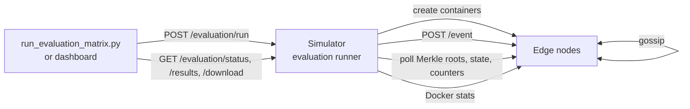

# Collaborative Edge Mesh

CRDT-based edge mesh for disaster analytics. Edge nodes exchange state by gossip, merge it with conflict-free data
types, and upload to the cloud through gateways.

## Components

- **Simulator** (`src/simulator_main.py`, `http://localhost:8000`): dashboard and API; creates edge-node containers
  and runs evaluations.
- **Gateway** (`src/gateway_main.py`, `http://localhost:7000`): collects and merges node state.
- **Edge nodes** (`src/node_main.py`): created on demand (`node-1`, `node-2`, ...). Each accepts events over HTTP,
  stores them in CRDT state with a hash-chain log, and gossips over UDP every 5 s.

## Setup

```bash
uv sync
make build            # build the Docker images
make docker-rebuild   # clean and start the simulator and gateway
make docker-clean     # stop everything, including edge nodes
```

## Run the experiments

The three experiments from the master's report (baseline, constrained resources, increased load) can be rerun
with one command each:

```bash
make docker-rebuild                  # start the system
experiments/run_experiments.sh 1     # 1, 2, 3 or all
```

Each call writes its runs, summary and figures to a new folder in `experiments/results/new/`. The report's own
results are in `experiments/results/previous/`. See [experiments/README.md](experiments/README.md) for what each
experiment tests and how to summarize and plot results.

## How a run works



### 1. Submit

```bash
uv run python scripts/run_evaluation_matrix.py --sync-mode true_delta --node-counts 5 \
  --events-per-node 15 --scenarios partition_heal --partition-splits 0.5 --repetitions 3 --out results/demo
```

The script sends the configuration to `POST /evaluation/run`, polls `/evaluation/status` until the run ends, then
writes `<out>/<label>/<run_id>.csv` (one row per repetition and scenario), `<run_id>-results.json` and
`<run_id>.json` (configuration and resource limits). `--resume` skips a configuration that already has matching
results. The dashboard uses the same endpoints. `scripts/run_reviewer_matrix.py` runs a CSV of configurations.

### 2. Parameters

| Parameter | Meaning | Values |
|---|---|---|
| `--sync-mode` | Synchronization method | `full_state`, `optimized_full_state`, `naive_key_delta`, `true_delta` |
| `--node-counts` | Mesh sizes | e.g. `5,10,15` |
| `--events-per-node` | Events sent to each node | e.g. `90` |
| `--scenarios` | What happens during the run | `baseline`, `partition_heal`, `high_load`, `shared_key`, `shared_counter`, `shared_set` |
| `--partition-splits`, `--partition-events-per-node`, `--partition-wait-seconds` | Group sizes, events sent during the partition, how long it is held | e.g. `0.5,0.7,0.8`, `15`, `30` |
| `--network-profile` | Delay, jitter, loss and bandwidth between nodes | `clean_lan`, `constrained_wifi`, `degraded`, `severe` |
| `--docker-cpus`, `--docker-memory` | Limits per node | e.g. `0.5`, `512m` |
| `--resource-mode` | Same limits for all nodes, or a mix of weaker and stronger nodes (`balanced_edge_v1`) | `uniform`, `heterogeneous` |
| `--offered-rate-per-second`, `--event-concurrency` | Sending rate and parallel requests | e.g. `10`, `25` |
| `--convergence-wait-seconds` | Deadline for all nodes to agree | e.g. `180` |
| `--repetitions`, `--scenario-seed` | Repetitions; seed (increased per repetition) | e.g. `10`, `7301` |
| `--cold-topology` | Recreate containers for every repetition | flag |

### 3. Execute (`src/evaluation/runner.py`)

For each node count and repetition, the runner:

1. Removes old nodes and creates new containers with the CPU and memory limits, then waits for `/health`.
2. For each scenario: resets node and gateway state, applies the network profile with `tc`, and starts sampling
   container resources.
3. Sends events directly to the nodes (`POST /event`, round robin), each with a tracking ID and submission time.
   - `baseline`: the events only. `high_load`: three times as many.
   - `partition_heal`: events, then `iptables` rules block traffic between the two groups, more events are sent
     on both sides, the partition is held, and the rules are removed.
4. Polls the nodes until their Merkle roots match and every node has every event, or the deadline passes.
5. Stops sampling and clears the network profile.

### 4. Metrics

| Metric | How it is gathered |
|---|---|
| Convergence time (`time_to_last_node_*`) | Each node records when it first saw each event; the runner subtracts the submission time |
| Recovery time (`recovery_after_heal_s`) | Last arrival at any node minus the time the partition was removed |
| Correctness (`converged`, missing events) | Matching Merkle roots, equal final state, no missing tracking IDs |
| Traffic (`protocol_sync_bytes_total`) | Nodes count gossip summaries, full-state and delta bytes; the runner sums them without measurement-only tracking data |
| CPU, memory, throttling, OOM | Docker stats sampled about every second per node; OOM kills from `docker inspect` |

## Inspect a running experiment

```bash
curl -s http://localhost:8000/evaluation/status | python -m json.tool
docker stats --no-stream
```
